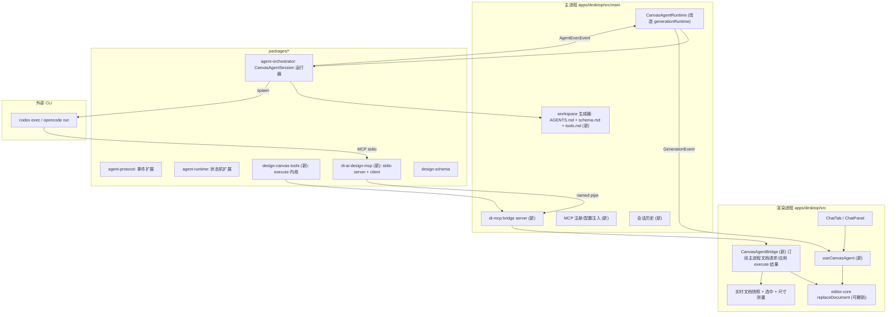
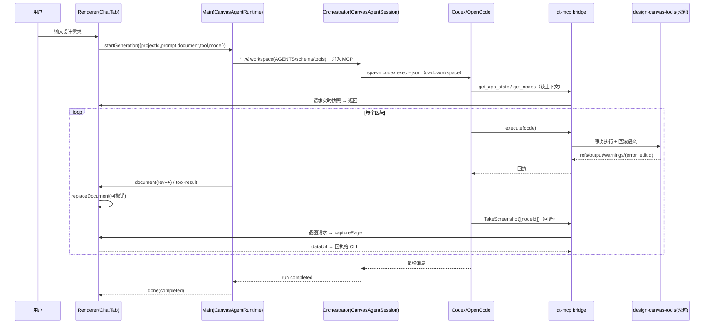
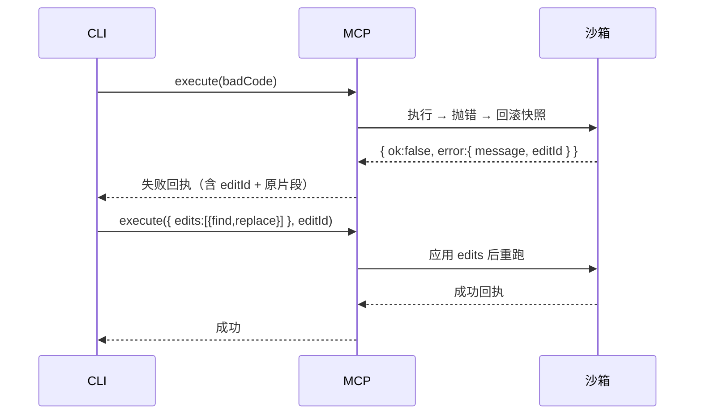

# Pencil（pen.dev）式 AI 画布智能体 —— 实施计划

- 日期：2026-10-16
- 状态：设计草案，待评审（§15 为实施状态）
- 目标读者：`dt-ai-design` 的 Agent / 前端 / 主进程工程师
- 相关包：`agent-orchestrator`、`agent-protocol`、`agent-runtime`、`agent-provider-*`、`design-schema`、`editor-core`、`apps/desktop`
- 参考系统：
  - `D:\frames\study\miaoma-design-ai`（妙码学院多智能体生成引擎，下文简称 **miaoma**）
  - pen.dev（下文简称 **Pencil / pen**，通过 `pen-dev` skill 的 `execute` / `pen-schema` 观察其对话实现）

---

## 0. TL;DR

当前 `dt-ai-design` 的 AI 能力是 **「一次性整文档 JSON 生成」**：`ChatTab → useGeneration → GenerationRuntime → Orchestrator.generateDocument → CodexProvider/OpenCodeProvider → Validator`，模型一次吐出整份 `DesignDocument`，失败就带着校验错误整份重生成（`packages/agent-orchestrator/src/index.ts:104`、`src/prompt.ts:13`）。

Pencil 的对话是 **「Agentic 工具循环」**：模型不吐整份文档，而是在一个画布工具 API（`execute` 跑一小段 JS）上 **增量、可回滚、可自检** 地一区块一区块地画，每一步都能 `Get`/`Print`/`TakeScreenshot` 回读校验，并用 `edits`+`editId` 修补失败片段。

本计划把 **miaoma 的编排骨架**（多智能体 Run 状态机、契约 JSON Schema、事件/IPC 流、MCP 读桥、截图视觉闭环）与 **Pencil 的执行模型**（工具循环、增量执行、事务回滚、回读校验、占位/组件/变量）结合，给出一条可落地的改造路线：

> **把「整文档 JSON 生成器」升级为「画布工具循环智能体」**：新增一个画布工具内核（`Insert/Copy/Update/Replace/Move/Delete/Get/SetVariables/Print/TakeScreenshot/FindEmptySpace`），通过 MCP（或进程内工具循环）暴露给 Codex/OpenCode，由编排器启动"一次设计会话"，桌面端实时把工具产生的文档增量落画布并做视觉验收。

---

## 1. 参考系统一：miaoma 的 AI Chat 实现

### 1.1 分层架构

miaoma 有 **两条独立的 AI 子系统**，都在 Electron 主进程汇合：

| 子系统                            | 作用                                                                                    | 关键文件                                                                                                       |
| --------------------------------- | --------------------------------------------------------------------------------------- | -------------------------------------------------------------------------------------------------------------- |
| **设计生成（内部 Agent 运行时）** | 自然语言 → 多智能体并行生成设计片段 → 组装 → 视觉校验/修复                              | `apps/desktop/client/generation/generationRuntime.ts`、`packages/miaoma-design-generation/src/orchestrator.ts` |
| **MCP 外部 Agent 桥**             | 把「当前打开的编辑器文档」以只读 MCP 工具暴露给外部 CLI（Codex），实现「设计稿 → 代码」 | `packages/miaoma-mcp/src/server.ts`、`bridge.ts`、`apps/desktop/client/mcp/*`                                  |

### 1.2 设计生成流水线（`orchestrator.ts`）

状态机（`packages/miaoma-agent-core/src/run.ts:18-45`）：
`queued → preparing → designing → validating → (repairing → validating)* → completed | cancelled | failed`

单次运行的顺序（`packages/miaoma-design-generation/src/orchestrator.ts:603-835`）：

1. **preparing**
   - `read-variables`：协调者 Agent 依据需求产出**设计变量草稿**（颜色/字体/间距），`applyMiaomaDesignVariables` 写入文档并 `onDocumentUpdated`。
   - `set-variables`：记录活动。
   - `plan-visual`：协调者产出**区域规划**（≤5 个 `assignment`，每个含 `regionId/label/bounds/targetNodeIds`、`objective`、`order`），`placeMiaomaDesignRegionScaffolds` 在文档里**预先放置占位 frame**（占位让画布先有骨架，workers 只做局部替换）。
2. **designing**
   - 最多 5 个协作者（`newton/tesla/maxwell/curie/faraday`）**并行**，各自只生成自己区域的 `fragment`（一个顶层 frame + 子树）。
   - 每个 worker 通过 `runActivity(kind:'design')` 包裹 `codex.execute(...)`；失败则回退为 **placeholder 片段**（`placeholderFragment`），不阻塞其它区域。
   - 结果经 `replaceMiaomaDesignRegionFragment` **串行合并**（`mergeQueue`）进文档，逐次 `onDocumentUpdated`。
3. **validating / repairing**
   - `visualHarness.validate`：截图（`captureScreenshot`）→ 让 Codex **看图**产出 `visual-check` JSON（passed/issues）。
   - 未通过则 `repair`：把 issue + 当前模块 JSON 交给 Codex，产出 `repair` JSON（只替换列出的 nodeIds），`replaceMiaomaDesignRepairs` 应用，回到 validating，最多 `maxRepairAttempts`（默认 2）次。

全部产物落 **固定 JSON Schema**（`packages/miaoma-design-generation/schemas/*.json`：`design-plan` / `design-variables` / `design-fragment` / `design-visual-check` / `design-repair`），引擎内严格解析（`contracts.ts`、`visualContracts.ts`）。

### 1.3 事件 / 活动 / 记录

- **Activity**（`packages/miaoma-agent-core/src/activity.ts`）：`bash / read-variables / set-variables / read-objects / check-guidelines / plan-visual / design / visual-check / repair`，状态 `running|completed|failed`，带 `input`（JSON）与 `output.summary`。UI 时间线逐条渲染。
- **Codex 事件流**（`packages/miaoma-agent-codex/src/jsonl.ts`）：`thread.started / turn.started / turn.completed / turn.failed / item.started / item.completed`（`command_execution`→bash 活动，`agent_message`→message）。
- **Run 持久化**：`miaoma-agent-history` 按 run 写文件；`broadcastHistory.saveRun` 顺带把 `run-updated` 推给渲染层。
- **进度回写**：`onDocumentUpdated` 在持久化后 `publish({type:'document-updated', runId, revision, document})`，并 **await** `waitForRendererDocument`（在渲染进程轮询 `[data-region="canvas-stage"]` 的 `data-generation-run-id/data-document-revision` 直到匹配，5s 超时）——**确保截图反映的是已渲染的这一版**（`generationRuntime.ts:62-104, 211-227`）。

### 1.4 MCP 读桥（外部 Agent）

- 工具（`packages/miaoma-mcp/src/server.ts`）：`get_app_state`、`get_selected_node`、`get_nodes`、`get_screenshot`、`get_assets`，全部只读。
- 通信两跳：**CLI 子进程 → sidecar exe（MCP stdio server）→ 命名管道 → Electron 主进程 bridge server → IPC → 渲染进程 broker**，返回实时文档快照（`rendererBroker.ts`、`McpEditorBridge.tsx`）。
- 截图用隐藏窗口加载 `/mcp-capture` 后 `capturePage` 取 PNG（`screenshotCapture.ts`）。
- 通过 `codex mcp add miaomadesign -- ...` 注册进 Codex（`registration.ts`）。

### 1.5 miaoma 的优点与局限

**优点**：契约驱动（JSON Schema 严格校验）、并行提速、视觉闭环、占位不阻塞、完善的活动时间线与历史、MCP 桥打通到外部 CLI。
**局限**：**不是工具循环**——每个 Agent 依然是一次「吐整份/整区域的 JSON」；模型无法边画边读边改；碎片化编辑（改一个节点、移动一个图层）能力弱；repair 只能整节点替换。

---

## 2. 参考系统二：Pencil（pen.dev）的对话实现

### 2.1 本质：Agentic 工具循环，而非一次性生成

Pencil 的「对话」= **LLM + 一组画布 MCP 工具** 的标准 agentic loop。模型看到：

1. **系统指令**（`pen-dev` skill：schema、`execute` 语义、设计准则、验证清单、风格原型等）；
2. **`get_app_state`** 返回的账号/选中/画板状态；
3. 目标节点/当前文档（`get_nodes`、`Get`）。

然后模型**反复调用工具**修改画布，每次拿到结构化回执（创建的 id 映射、警告、`Print` 输出、截图），据此决定下一步，直到完成并自检。

### 2.2 `execute` 工具的语义（核心）

`execute` 执行一小段 JS，暴露一个**受限的画布 API**（`pen-dev` skill `execute.md`）：

- 变更类：`Insert(parent, nodeData)→id`、`Copy(path,parent,overrides)→id`、`Update(path,data)`、`Replace(path,nodeData)→id`、`Move(path,parent,index)`、`Delete(path)`、`SetVariables(vars,replace?)`。
- 读取类：`Get(path[,visit][,options])`（可带 `depth`/`resolveVariables`/`resolveInstances`；visitor 里 `ctx.bounds`/`ctx.problems` 用于**结构尺寸自检**）、`GetVariables()`、`FindEmptySpace({width,height,...})→{x,y,parentId?}`、`Print(...values)`（回执读值）、`TakeScreenshot(nodeIds)`（**同一次调用内**即可对刚画的区块截图，随回执返回图片）。
- 语义要点（正是我们要复刻的）：
  - **事务性**：出错则**本次所有修改与全局变量全部回滚**；
  - **失败修补**：失败时用 `edits`+`editId` 改片段重跑，**不要整段重发**；
  - **id 映射回执**：每次 `execute` 把「name→id」映射返回，供后续调用引用；
  - **独立作用域**：每次 `execute` 的局部变量/函数不共享；跨调用持久化要用**不加 `let/const` 的全局赋值**（`myId = Insert(...)`）；
  - **id 由系统生成**：不接受模型传 `id`；
  - **`placeholder: true` 工作流**：新建/修改的根 frame 在整个工作期间打 `placeholder`，画完立即移除；
  - **`ref` + `descendants`**：组件实例化与后代覆盖在**同一次 Copy/Insert 内**完成（避免 id 失配）；
  - **`Get` 反映同调用内的先前修改**（可读回刚创建的内容）。

### 2.3 处理流程

```
用户请求
  └─ Agent 读取 app_state / 选中 / 相关节点
       └─ (循环) 设计下一区块 → execute(JS)
            ├─ 成功：返回 id 映射 + 警告；可选 TakeScreenshot 自检
            └─ 失败：回滚 + 报错 + editId → 用 edits 修补重跑
       └─ 每个区块画完立即 Get/Print/TakeScreenshot 验证（不等全部结束）
       └─ 阶段收尾移除 placeholder，做整体检查清单
  └─ 最终给用户可见的 Markdown 回复
```

### 2.4 提示词体系（pen-dev skill 摘要）

- **总指令**：偏「复制已有内容再改」而非从零造；只做被要求的事；画布是多人协作、状态可能过期，**发现不符应重读而不是重建**；不要让用户长时间看不到进度；不要把 CSS/HTML 概念带进来；schema 没有的属性就是不支持；每画完一段**立即验证**；审查后**不要删除重画，直接改**。
- **对象/坐标/布局规则**：坐标相对父左上；只有 frame/group 能有子节点；属性**不继承**；尽量用 `fill_container`/`fit_content` 而非硬编码；文本必须设 `fill` 否则不可见；`textGrowth` 决定换行与尺寸；不支持百分比尺寸。
- **质量清单**：布局不坍塌、内容不被裁剪、对比度足够、对齐与间距正确、意图与 schema 一致。
- **风格原型**：`get_style` 提供 26 种可配置风格（字体/色彩/意象）。
- **占位 / 组件 / 变量 / 图表**规则：见 §2.2。

---

## 3. 两系统对比与取舍

| 维度          | miaoma                      | Pencil                           | dt-ai-design 现状   | 采纳                                  |
| ------------- | --------------------------- | -------------------------------- | ------------------- | ------------------------------------- |
| 生成粒度      | 整区域 JSON 一次性          | 小段 JS 增量执行                 | 整文档 JSON 一次性  | **Pencil 增量工具循环**               |
| 模型可回读    | 否（只能看截图）            | 是（`Get`/`Print`/`ctx.bounds`） | 否                  | **Pencil**                            |
| 事务/回滚     | 无（片段级替换）            | 有（execute 整体回滚）           | 无                  | **Pencil**                            |
| 视觉闭环      | 有（截图+repair，run 级）   | 有（区块级 `TakeScreenshot`）    | 无                  | **两者结合：区块级 + run 级**         |
| 并行/多 Agent | 有（≤5 协作者 + 区域规划）  | 单 Agent                         | 有骨架但未接线      | **miaoma 骨架，二期启用**             |
| 契约          | JSON Schema 强约束          | 工具入参/回执 + rename 约束      | Zod + 整文档 schema | **保留 Zod；新增工具入参/回执契约**   |
| 事件/时间线   | 完整 Activity 模型          | 工具调用/回执                    | AgentRun + 简化事件 | **扩展 dt 事件模型**                  |
| 外部桥        | MCP 只读                    | MCP 读写（execute）              | 无                  | **新增 dt MCP（读写 execute）**       |
| 进度可见      | document-updated + 渲染等待 | 实时应用每次 execute             | 单次 document 事件  | **每次 execute → 一个 revision 事件** |

**结论**：以 Pencil 的「执行/回读/事务」为核心，用 miaoma 的「编排/契约/事件/MCP/截图闭环」做工程骨架。

---

## 4. 目标架构

### 4.1 总体



### 4.2 分层与职责

| 层     | 包/文件                                         | 职责                                                          |
| ------ | ----------------------------------------------- | ------------------------------------------------------------- |
| 内核   | `packages/design-canvas-tools`（新）            | 纯逻辑的画布 API + JS 沙箱 + 事务/回滚；操作 `DesignDocument` |
| 桥     | `packages/dt-ai-design-mcp`（新）               | MCP stdio server（暴露 `execute`/读工具）+ 命名管道 client    |
| 编排   | `packages/agent-orchestrator`                   | 生成 workspace、spawn CLI、驱动会话、可选规划/视觉阶段        |
| 协议   | `packages/agent-protocol`                       | 扩展 `AgentEventType`（tool 调用/回执/document/verify）       |
| 运行时 | `packages/agent-runtime`                        | 扩展会话状态机（`editing/verifying`）与活动模型               |
| 主进程 | `apps/desktop/src/main/*`                       | `CanvasAgentRuntime`、MCP bridge server、注册、历史           |
| 渲染   | `apps/desktop/src/lib/*`、`components/editor/*` | 工具回执应用到编辑器（可撤销）、时间线、快照/尺寸测量         |

---

## 5. 详细设计

### 5.1 画布工具内核 `packages/design-canvas-tools`

目标：对 `DesignDocument`（扁平 `layers: Record<string, Layer>`，`children: string[]`，`rootLayerIds`，`components`，`variables`）实现 pen 式 API。

```ts
// packages/design-canvas-tools/src/types.ts
export interface CanvasSession {
  doc: DesignDocument; // 可变工作副本
  globals: Record<string, unknown>; // 跨 execute 持久化（对应 pen 的"不加 const"）
  refs: Map<string, string>; // name → id 映射（回执用）
}

export interface ToolWarning {
  code: string;
  message: string;
  nodeId?: string;
}

export interface ExecuteResult {
  ok: boolean;
  revision: number; // 每次成功的 execute +1
  refs: Record<string, string>; // 新建节点 name→id
  output: string[]; // Print 输出行
  warnings: ToolWarning[];
  screenshots?: { nodeId: string; dataUrl: string }[]; // TakeScreenshot 结果（渲染层回填）
  error?: { message: string; editId: string; line?: number }; // 失败：附 editId 供 edits 修补
  documentChanged: boolean;
}
```

核心操作（在扁平模型上）：

- `Insert(parentId, nodeData) → id`：生成随机 id（忽略模型传入 id），写入 `layers`，挂到父的 `children`（或 `rootLayerIds`）。父必须是 `frame/group`。
- `Copy(path, parentId, overrides?) → id`：深拷贝子树，全部新 id，重建 `children`；`overrides.descendants` 用「原子路径或 name」映射覆盖后代的属性/替换（**必须在本次调用内完成**）。
- `Update(path, data)`：写属性（**禁止改 `id/type`**）。
- `Replace(path, nodeData) → id`：整节点替换（含新 id）。
- `Move(path, parentId?, index?)`：从旧父 `children` 摘除并插入新位置。
- `Delete(path)`：递归删除子树，清理 `layers`。
- `Get(path | visitor, options?)`：读节点/子树；visitor 提供 `ctx.bounds`（解析后包围盒）、`ctx.problems`（是否被父裁剪）、`ctx.parentCtx`、`skipChildren()`。
- `SetVariables(vars, replace?)` / `GetVariables()`：映射到 `document.variables`（`DesignVariable{id,name,type,value}`；键用 `name`）。
- `FindEmptySpace({width,height,direction?,padding?,anchorId?}) → {x,y,parentId?}`：在 `document` 根下寻找不重叠空位（供多屏布局）。
- `Print(...values)`：写入 `result.output`。
- `TakeScreenshot(nodeIds)`：登记待截图节点，由渲染层 `capturePage` 回填 `screenshots`（见 §5.6）。

**事务/回滚**：`execute(code)` 前 `structuredClone(doc)` 做快照；沙箱内抛错 → 恢复快照 + 清空本轮的 `globals` 增量 → 返回 `{ok:false, error:{editId}}`。`editId` 由主进程为每个失败片段生成，承载「上一次片段源码」，供 `edits:[{find,replace,all?}]` 修补重跑（等价 pen 的 edit 机制）。

**沙箱**：用 `new Function` 注入受限 API（`Insert/Get/...`）与一个只读的 `document` 根 id 字符串；禁止 `require/import/fetch/process`（`codex` 侧本就无网络沙箱概念，但沙箱要屏蔽 Node 全局）。可选：用 `node:vm` 的 `vm.Script` 提供更严格隔离与超时（`timeout` 几秒）。

> 变量引用：dt schema 暂无 `$var` 引用语法。一期先支持「变量按 name 定义 + 节点属性用字面量」；二期在 `design-schema` 增加 `VariableRef = string`（以 `$` 前缀）并在渲染前 `resolveVariables`，与 pen 对齐。

### 5.2 execute 与 JS 生成约定（对齐 pen）

- 鼓励用数组/`for...of`/spread/helper 生成重复结构（导航项、表格行、卡片）。
- 每条新增/改动节点必须设 `name`（用于回执 name→id 映射与后续引用）。
- 不写注释；片段尽量短。
- 跨 `execute` 持久化用**不加 `let/const` 的赋值**（在沙箱里环境对象是 `session.globals`），因此 `myId = Insert(...)` 可在下一次调用里引用。这通过把 `globals` 作为 `with`/Proxy 环境暴露实现。
- `placeholder: true`：映射为 `layer.metadata.placeholder`（`LayerMetadata` 已可扩展，见 `design-schema/src/types/base.ts:22`）。新建/修改的顶层 frame 在完成前带该标记，画完移除。

### 5.3 MCP 服务与桥接 `packages/dt-ai-design-mcp`

复刻 miaoma 的 `miaoma-mcp`（`server.ts` + `bridge.ts` + `sidecar.ts`）结构：

- **工具**（读写）：
  - `get_app_state()`：app 是否运行 / 当前项目 / 选中节点 id / revision。
  - `get_selected_node()` / `get_nodes(nodeIds[])`：返回规范化节点子树（image fill 替换为 `dt-asset://<hash>`）。
  - `get_variables()`。
  - `get_screenshot(nodeId?)`：返回图片（用于 run 级验收；区块级截图走 `execute` 内 `TakeScreenshot`）。
  - **`execute(code, edits?, editId?)`**：核心写工具。转发到主进程 → 渲染层执行沙箱 → 回执（refs/output/warnings/documentChanged/screenshots/error）。
- **错误码**：`APP_NOT_RUNNING / NO_ACTIVE_EDITOR / NO_SELECTION / NODE_NOT_FOUND / INVALID_NODE_TYPE / SCREENSHOT_FAILED / EXECUTE_FAILED / STALE_REVISION`。
- **通信**：与 miaoma 相同的两跳（CLI stdio → sidecar → 命名管道 → 主进程 bridge server → IPC → 渲染层 broker）。Windows 命名管道名 `\\.\pipe\dt-ai-design-mcp-<hash>`。
- **注册**：Codex 用 `codex mcp add dt-ai-design -- <sidecar> ...`；或（推荐，避免全局污染）每次运行生成临时 `-c mcp_servers...` / 用 `--mcp-config` 注入到该次 `codex exec`。opencode 用其 MCP 配置注入。

> 一期可先不落地独立 sidecar 打包，用 **进程内 MCP（in-process stdio 到子进程的管道）** 简化；二期再 sidecar 化（同 miaoma）。

### 5.4 编排器：`CanvasAgentSession`（`agent-orchestrator`）

新增一个会话运行器（保留现有 `Orchestrator.generateDocument` 作为「整文档快速模式」的降级路径）：

```ts
export interface CanvasAgentSessionInput {
  sessionId: string;
  projectId: string;
  prompt: string;
  document: DesignDocument; // 起始快照
  cwd: string; // 生成的 workspace（含 AGENTS.md/schema.md）
  model?: string;
  signal?: AbortSignal;
  onDocumentUpdated?: (
    doc: DesignDocument,
    revision: number,
  ) => Promise<void> | void;
  onScreenshotRequested?: (
    nodeIds: string[],
  ) => Promise<Record<string, string>>;
}

export class CanvasAgentSession {
  // spawn CLI（codex exec --json / opencode run --format json），
  // 注入 MCP 配置指向 dt-ai-design-mcp，
  // 消费 JSONL 事件 → 映射 AgentExecEvent → 驱动 AgentRun，
  // 直到 turn 完成或取消。
}
```

要点：

- **workspace 生成器**：每次运行在 `userData/agent-workspace/<sessionId>/` 写入 `AGENTS.md`（§6）、`schema.md`（`.dt` 摘要）、`tools.md`（execute API）、可选的 `styles/*.json`（风格原型）。CLI 以该目录为 `cwd`。
- 若启用 **规划阶段**（可选，借鉴 miaoma）：先跑一次 `plan` 调用（JSON Schema 输出）得到区块划分，写入 `AGENTS.md` 的「本次任务」段落，再开主工具循环。
- **视觉阶段**（可选）：会话结束后用 `get_screenshot` + 一次 `visual-check`（JSON）判断，未过则再发起一次带 issue 的 `execute` 修复会话。

### 5.5 运行时与事件扩展（`agent-protocol` / `agent-runtime`）

`agent-protocol/src/events.ts` 扩展：

```ts
export type AgentEventType =
  | 'agent:started'
  | 'agent:plan'
  | 'agent:step'
  | 'agent:completed'
  | 'agent:failed'
  | 'agent:tool-call' // { tool, args, callId }
  | 'agent:tool-result' // { callId, ok, summary, warnings }
  | 'agent:document' // { revision, docApplyPatch }
  | 'agent:screenshot'; // { nodeIds }
```

`agent-runtime/src/lifecycle/index.ts`：`AgentStage` 增加 `editing` / `verifying`；`AgentRun` 增加 `nextRevision()` 与 `emitDocument()`、`emitToolCall/Result()`。

活动模型：把 `agent-provider-core` 的 `AgentActivity.kind` 从只读 `'bash'` 扩展为 `'bash' | 'tool-call' | 'edit' | 'verify'`（或保持 bash 显示 shell，另加 `tool` 字段）。为兼容性，先只新增 `kind` 可选值，UI 增加图标/文案。

### 5.6 桌面端

**主进程 `CanvasAgentRuntime`（改造 `generationRuntime.ts`）**：

- 单飞行（沿用）；`start(sender, input)` 构造 `CanvasAgentSession`，`onDocumentUpdated` 推 `document` 事件（复用现有 `GenerationEvent.type:'document'`，`revision` 自增）。
- **MCP bridge server**：启动命名管道 server，处理 `execute`/读请求 → 转发渲染层（`CanvasAgentBridge`），带超时与错误码（对齐 miaoma `bridge.ts`）。
- **注册/注入 MCP**：见 §5.3。
- **历史**：会话与每次 revision 落盘（可选用 miaoma 的 file 历史存储思路）。

**渲染层**：

- `lib/useCanvasAgent.ts`（替代/并列 `useGeneration.ts`）：订阅事件，把 `tool-call/tool-result/document` 渲染成时间线；`document` 事件经 `editor.replaceDocument` 落画布（可撤销）。
- `components/editor/CanvasAgentBridge.tsx`（对齐 miaoma `McpEditorBridge.tsx`）：响应主进程的文档/执行请求：
  - 返回实时快照（`editor.getDocument()` + 选中 + 尺寸测量，尺寸经 `data-layer-id` DOM `offsetWidth/Height`）；
  - 执行 `execute` 沙箱在**主进程**跑（内核在 Node），渲染层只负责 **截图回填**（`TakeScreenshot` → `capturePage`/DOM 渲染截图）。
- **粒度与撤销**：每次成功 `execute` 产生一个 revision，`replaceDocument` 一次 → 一次撤销步。可配置「同一 turn 内合并为一个撤销步」。
- UI：把现有 `LeftPanel` 的 `ChatTab` 升级为「AI 面板」，展示工具调用行（`Insert`/`Update`/`execute` 摘要）、warnings、可展开的 `Print` 输出、内联截图；保留工具/模型选择器（`useAgentModel`）。

### 5.7 多智能体（二期）

如果后续需要并行/加速，复用 miaoma 的规划+协作者模型：

- 协调者先产出 `plan`（区域 `bounds/targetNodeIds`）并放占位 frame；
- 每个协作者在**独立 workspace + 独立会话**里只对分配区域跑工具循环（提示词限定 regionId）；
- 合并用「按 regionId 替换」的 `applyPatch`（对齐 `replaceMiaomaDesignRegionFragment`）。
- 一期**不启用**（Pencil 本身是单 Agent；工具循环足够，且并行会带来文档并发写冲突）。

---

## 6. 提示词体系（详细草稿）

### 6.1 `AGENTS.md`（写入 workspace，供 Codex/OpenCode 读取）

```md
# dt-ai-design 画布设计智能体

你是内置在「深迪设计」画布中的 UI 设计智能体。你不能输出整份文档 JSON，
而是通过 `execute` 工具在画布上增量地、可回滚地创建与修改图层，并用
`Get`/`Print`/`TakeScreenshot` 回读校验。

## 工作方式

- 每次调用 `execute` 写一小段 JavaScript（不写注释，尽量短），只做当前区块。
- 使用数组、`for...of`、对象展开、helper 生成重复结构，避免手写重复代码。
- 每个新节点必须设置 `name`（人类可读），回执会返回 name→id 映射，供后续引用。
- 跨 `execute` 持久化 id：直接赋值，不要用 `const/let`（如 `heroId = Insert(...)`）。
- 不要传 `id`，系统会生成唯一 id。
- 失败时不要重发整段；用返回的 `editId` + `edits:[{find,replace}]` 修补后重跑。
- 画完一个区块**立即**用 `Get`/`Print`/`TakeScreenshot` 验证，不要等全部结束。
- 新建/修改的顶层 frame 在整个工作期间设 `placeholder: true`，画完立刻移除。

## 坐标系与结构

- 坐标相对父节点左上角；x 向右、y 向下。
- 只有 `frame` / `group` 可以有子节点。
- 尽量用 `sizingMode: "fillContainer" | "hugContents"` 与 frame 的 `layout`，少用硬编码尺寸。
- text 默认不可见，**必须设 `fills`**；换行需靠宽度 + frame 布局，不要猜尺寸。
- frame 布局是单轴（horizontal/vertical），网格需手写行 frame。

## 设计准则

- 最外层一个画板 frame（桌面 1440 宽 / 移动 375 宽），内容全部在画板内。
- 视觉品质：间距有节奏、字号分级（12/14/16/24/32）、色彩分层（背景/表面/主文本/次文本/强调）。
- 避免每个元素都套盒子；避免过度渐变/阴影/圆角；图标用 icon 型（暂用文字/形状代替）。
- 不要在画板根直接放文本/按钮/卡片，只放页面 frame 与容器 frame。

## 验证清单（每次收尾自检）

- 布局未坍塌、内容未被裁剪（`Get` 的 `ctx.problems` 检查）。
- 文本对比度足够、对齐与间距正确。
- 与需求意图一致。

## 工具

详见 `tools.md`；schema 详见 `schema.md`。
```

### 6.2 `schema.md`（`.dt` schema 摘要，自动从 `design-schema` 生成）

内容要点（与 `design-schema` 对齐）：`DesignDocument{layers,rootLayerIds,components,variables,meta}`；`BaseLayer` 必填字段（`id,name,type,x,y,width,height,rotation,opacity,visible,locked,parentId,index,blendMode,layerPosition`）；各 `Layer` 特有字段（frame 的 `children/layout/sizingMode`、text 的 `fontSize/fills` 等）；`FillStyle`/`StrokeStyle`/`EffectStyle`/`FrameLayout`/`SizingMode` 枚举；并**明确列出不支持的概念**（无 margin、无百分比、无 `alignItems: stretch`、无 CSS 属性），避免模型幻觉。

> **必须与 Zod schema 同步生成**，避免提示词与校验漂移（现有 `prompt.ts` 已存在这种风险：`DOC_SPEC` 只覆盖 4 种 layer 类型，而 schema 支持 12 种）。

### 6.3 `tools.md`（execute API 文档，改写自 pen `execute.md`）

按 pen 的 `execute.md` 结构写：API 列表、`Insert/Copy/Update/Replace/Move/Delete/Get/SetVariables/GetVariables/Print/TakeScreenshot/FindEmptySpace` 的语义与示例、`Get` visitor 与 `ctx.bounds/problems`、`descendants` 覆盖、`placeholder` 工作流、`edits/editId` 修补规则。

### 6.4 阶段提示词（可选；借鉴 miaoma）

- **variables**：`buildVariablePrompt`（`orchestrator.ts:127`）。
- **plan**：`buildPlanPrompt`（`orchestrator.ts:138`），产出区域 `bounds/targetNodeIds`。
- **worker/region**：`buildWorkerPrompt`（`orchestrator.ts:163`），限定只画分配区域。
- **visual-check / repair**：`harness.ts:40`、`:57`（看图给 issue、只替换列出的 nodeIds）。

这些都要求**严格 JSON Schema 输出**（见 §7）。

---

## 7. 契约 / JSON Schema 文件清单

一期（工具循环）核心不需要新的输出 schema；若启用阶段化，迁移/对齐 miaoma 的 schema：

| 文件                                   | 用途                                         | 来源                             |
| -------------------------------------- | -------------------------------------------- | -------------------------------- |
| `design-variables.schema.json`         | 设计变量草稿                                 | miaoma 直接复用（字段改名为 dt） |
| `design-plan.schema.json`              | 区域规划（含 bounds/targetNodeIds）          | miaoma 直接复用                  |
| `design-fragment.schema.json`          | 区域片段（可选，用于局部整块替换）           | miaoma 复用                      |
| `design-visual-check.schema.json`      | 视觉检查（passed/issues）                    | miaoma 复用                      |
| `design-repair.schema.json`            | 修复批次（只替换 nodeIds）                   | miaoma 复用                      |
| **`execute-result.schema.json`（新）** | `execute` 回执（refs/output/warnings/error） | 新增                             |

落盘位置：`packages/agent-orchestrator/schemas/` 或新包 `design-canvas-tools/schemas/`，并提供一个路径解析器（对齐 `miaoma-design-generation/src/schemaPaths.ts`）。

---

## 8. 事件与 IPC 契约

扩展 `apps/desktop/src/shared/ipc-types.ts` 的 `GenerationEvent`：

```ts
export type GenerationEvent =
  | { type: 'stage'; runId: string; stage: GenerationStage; message?: string }
  | { type: 'activity'; runId: string; activity: GenerationActivity }
  | {
      type: 'tool-call';
      runId: string;
      callId: string;
      tool: string;
      args: unknown;
    }
  | {
      type: 'tool-result';
      runId: string;
      callId: string;
      ok: boolean;
      summary: string;
      warnings?: ToolWarning[];
    }
  | { type: 'message'; runId: string; text: string }
  | {
      type: 'document';
      runId: string;
      revision: number;
      document: DesignDocument;
    }
  | {
      type: 'screenshot';
      runId: string;
      nodeIds: string[];
      image: string; /* dataUrl */
    }
  | {
      type: 'done';
      runId: string;
      status: 'completed' | 'failed' | 'cancelled';
      error?: string;
    };
```

`GenerationStage` 增加 `'editing' | 'verifying'`。

主进程 ↔ MCP bridge 的请求/响应（对齐 miaoma `types.ts`）：
`{ id, request: { type:'execute'|'get-state'|'get-nodes'|'get-selected'|'get-screenshot'|'get-variables', payload } }`，
响应 `{ id, result }` 或 `{ id, error:{ code, message } }`。

---

## 9. 处理流程时序

### 9.1 单次工具循环（主路径）



### 9.2 失败修补



---

## 10. 分阶段实施计划

> 采用 TDD（每个内核函数先写 vitest 失败用例）。命令约定：`pnpm --filter <pkg> test:run`、`pnpm -r typecheck`。

### 阶段 0：准备（0.5d）

- [ ] 评审本设计；确认一期范围（工具循环、单 Agent、MCP 读写、区块级截图；多智能体/风格原型/资产系统二期）。
- [ ] 明确变量引用（`$name`）是否一期落地。
- [ ] 更新 `doc/execution-tracker.md`（当前 tracker 仍把 AI 引擎标为 ~5% stub，与实际不符）。

### 阶段 1：画布工具内核 `design-canvas-tools`（3–4d）

- [ ] 脚手架包（`package.json`/`tsconfig`/`tsdown`，零运行时依赖，`tsconfig.base.json` 注册 paths）。
- [ ] 实现 `Insert/Update/Delete/Move`（含 id 生成、父子维护、`rootLayerIds` 维护）+ 单元测试。
- [ ] 实现 `Get`（含 visitor、`ctx.bounds`、`ctx.problems`、`depth`、`resolveVariables`）+ 测试。
- [ ] 实现 `Copy`（深拷贝新 id + `descendants` 覆盖）+ 测试。
- [ ] 实现 `Replace`、`SetVariables/GetVariables`、`Print`、`FindEmptySpace` + 测试。
- [ ] 实现 `execute(code, {edits, editId})`：`node:vm` 沙箱、事务快照/回滚、`globals` 持久化环境、warnings 收集、`editId` 生成 + 测试（含「出错回滚」「edits 修补」「跨调用全局」用例）。
- [ ] 导出 `execute-result.schema.json`。

### 阶段 2：MCP 桥 `dt-ai-design-mcp`（2–3d）

- [ ] 脚手架包；实现 stdio MCP server（`execute` + 读工具），对齐 miaoma `server.ts` 的 `withToolErrors`/annotations 风格。
- [ ] 实现命名管道 client（`bridge.ts` 移植）。
- [ ] 主进程 bridge server + 请求路由到渲染层（对齐 `rendererBroker`）。
- [ ] 渲染层 `CanvasAgentBridge`：快照、尺寸测量、截图回填。
- [ ] 单测：server 工具入参校验、bridge 往返、错误码。

### 阶段 3：编排器与运行时（3–4d）

- [ ] `agent-protocol` 扩展事件类型（tool-call/tool-result/document/screenshot）。
- [ ] `agent-runtime` 扩展 stage（editing/verifying）与 `emitToolCall/Result/emitDocument`。
- [ ] `agent-orchestrator` 新增 `CanvasAgentSession` + workspace 生成器（`AGENTS.md`/`schema.md`/`tools.md` 模板）。
- [ ] MCP 配置注入（codex `-c`/`--mcp-config`、opencode MCP 配置）。
- [ ] 事件映射 `AgentExecEvent → AgentEvent`（tool 调用/回执）。

### 阶段 4：主进程运行时 & IPC（2d）

- [ ] 改造 `apps/desktop/src/main/generationRuntime.ts` → `canvasAgentRuntime.ts`（复用单飞行/取消/会话续接）。
- [ ] 启动/关闭 MCP bridge server；注册或按次注入 MCP。
- [ ] `ipc-types.ts` 扩展事件；`ipcHandlers.ts` 接线。
- [ ] 保留旧 `Orchestrator.generateDocument` 作为降级开关（settings）。

### 阶段 5：渲染层 UI（2–3d）

- [ ] `lib/useCanvasAgent.ts`（时间线：user/stage/tool-call/tool-result/assistant/screenshot）。
- [ ] Chat 面板展示工具调用、warnings、`Print` 输出、内联截图。
- [ ] `document` 事件落画布 + 撤销粒度策略。
- [ ] 保留工具/模型选择器；运行中态、取消、错误态。

### 阶段 6（可选）：阶段化与视觉闭环（2–3d）

- [ ] 迁移 `variables/plan/visual-check/repair` schema 与提示词。
- [ ] 会话前规划、会话后视觉检查/修复循环（`maxRepairAttempts`）。
- [ ] 历史存储（run + revisions）。

### 阶段 7（可选，二期）：多智能体并行

- [ ] 区域规划 + 占位 frame + 多协作者独立会话 + 按 regionId 合并。
- [ ] 风格原型（`styles/*.json`，`get_style` 等价工具）。

### 验收（一期）

- Chat 输入「做一个 SaaS 落地页」→ 时间线可见多次 `execute` 调用，画布**逐步**出现内容（非一次性闪现）。
- 故意构造一个错误片段 → 回执含 `editId`，模型用 `edits` 修补成功。
- `TakeScreenshot` 能在区块画完后内联返回截图。
- 取消可中断 CLI 子进程（树杀）并回滚进行中的 revision。
- `pnpm -r typecheck` 与各包 `test:run` 全绿。

---

## 11. 测试策略

- **内核单测**（最重要）：每个工具函数的树操作、id 唯一性、事务回滚、`edits` 修补、`globals` 跨调用、`Get` visitor 的 `bounds/problems`。
- **契约测试**：`execute-result` 回执 shape；阶段 JSON Schema 解析（迁移 miaoma `contracts.ts` 用例）。
- **bridge 往返**：命名管道请求/响应、超时、错误码。
- **编排测试**：mock provider 产出 JSONL（tool 调用/回执），断言事件序列与 document revision 单调递增。
- **UI 测试**：`@testing-library/react` 渲染时间线；document 事件触发 `replaceDocument`。
- **端到端（手动）**：见阶段验收。

---

## 12. 风险、权衡与 YAGNI

| 风险               | 说明                                                           | 缓解                                                                        |
| ------------------ | -------------------------------------------------------------- | --------------------------------------------------------------------------- |
| 提示词/schema 漂移 | 提示词描述与 Zod 校验不一致（现 `DOC_SPEC` 仅覆盖 4 种 layer） | `schema.md` 由 `design-schema` **自动生成**；CI 校验                        |
| 沙箱安全           | `execute` 跑模型给的 JS                                        | `node:vm` + 无 Node 全局 + 超时；只暴露画布 API                             |
| JS 片段失控        | 模型写出巨大/错误片段                                          | 事务回滚 + `editId` 修补约定；片段长度软限制                                |
| 并发写冲突         | 多 Agent/多人同时改                                            | 一期单 Agent；revision 冲突返回 `STALE_REVISION`                            |
| 截图开销           | 每次 execute 都截图太贵                                        | 约定「只在一个区块完成时截一次」，且优先小区块                              |
| MCP 注册污染       | `codex mcp add` 改全局配置                                     | 优先按次注入（临时 config），不改全局                                       |
| 变量引用缺失       | dt schema 无 `$var`                                            | 一期字面量；二期加 `VariableRef` 与 `resolveVariables`                      |
| 撤销粒度           | 每 execute 一步会很多步                                        | 可合并同一 turn 为一个撤销步（配置）                                        |
| 平台差异           | Windows `.cmd` 代理、命名管道                                  | 复用 `agent-provider-core` 的 `spawnCli/terminateTree`；命名管道对齐 miaoma |

**YAGNI（一期不做）**：生成图片/矢量（`Generate`）、shader、脚本节点（`script`）、实时多人协作、导出 HTML/CSS、风格原型库、资产系统、多屏自动布局美化。

---

## 13. 附录：pen → dt schema 字段映射

| pen（.pen）                               | dt（design-schema）                                                          | 说明                                     |
| ----------------------------------------- | ---------------------------------------------------------------------------- | ---------------------------------------- |
| `document`（根字符串）                    | `DesignDocument` + `rootLayerIds`                                            | 根操作对象                               |
| `frame`（children, layout, padding, gap） | `FrameLayer`（children, layout{padding{top,right,bottom,left}}, sizingMode） | layout 单轴一致                          |
| `text`（content, textGrowth, fill）       | `TextLayer`（content, sizing, fills）                                        | `textGrowth`→`sizing`；文本必须 `fills`  |
| `rectangle/ellipse/polygon/path/icon`     | `RectangleLayer/EllipseLayer/PolygonLayer/PathLayer`                         | icon 一期用形状/文本代替                 |
| `image` fill（url, mode）                 | `ImageLayer` / `FillStyle{type:'image'}`                                     | 资产经 `dt-asset://` 桥                  |
| `$variable` 引用                          | 暂无 → 建议新增 `VariableRef`                                                | 见 §12                                   |
| `ref` + `descendants`                     | `ComponentInstanceLayer`（componentId, overrides）                           | 覆盖语义需在内核实现                     |
| `placeholder: true`                       | `metadata.placeholder`                                                       | 扩展 `LayerMetadata`                     |
| `SetVariables/GetVariables`               | `document.variables`（`DesignVariable`）                                     | 键用 `name`                              |
| `TakeScreenshot`                          | 渲染层 `capturePage` / DOM 截图                                              | run 级 + 区块级                          |
| `Get(ctx.bounds/problems)`                | 新内核计算（`getLayerBounds` 已有，需加裁剪检测）                            | 复用 `design-schema` 的 `getLayerBounds` |
| `FindEmptySpace`                          | 新内核（基于 `rootLayerIds` 包围盒）                                         | —                                        |

---

## 14. 与现有代码的衔接点（速查）

- 现有单文档生成：`packages/agent-orchestrator/src/index.ts:104`、`src/prompt.ts:57`、`src/validator/index.ts:16`。
- 现有运行时：`apps/desktop/src/main/generationRuntime.ts`（改造为 canvasAgentRuntime）。
- 现有事件/IPC：`apps/desktop/src/shared/ipc-types.ts:85`、`apps/desktop/src/lib/useGeneration.ts:59`。
- 现有协议/运行时：`packages/agent-protocol/src/events.ts`、`packages/agent-runtime/src/lifecycle/index.ts:14`。
- 现有 provider 接口：`packages/agent-provider-core/src/types.ts:35`（`AgentExecRequest` 需加 `mcp`/工具配置透出）。
- 设计文档模型：`packages/design-schema/src/types/document.ts:48`、`types/layers.ts:182`、`types/styles.ts:131`、`types/base.ts:56`。
- 编辑器落盘：`packages/editor-core` 的 `replaceDocument`（`apps/desktop/src/lib/editor.ts:84`）。

---

## 15. 实施状态（2026-10-16 完成）

在分支 `feat/pencil-like-canvas-agent` 上已实现全部 7 个阶段（库/契约层面），`pnpm -r typecheck`、`pnpm -r test:run`（194 tests）、`pnpm build:packages`、变更文件 eslint 全绿。

| 阶段           | 交付                                                                                                                                                                                                                                                                                                                                                                       |
| -------------- | -------------------------------------------------------------------------------------------------------------------------------------------------------------------------------------------------------------------------------------------------------------------------------------------------------------------------------------------------------------------------- |
| 1 画布工具内核 | `packages/design-canvas-tools`：`Insert/Copy/Update/Replace/Move/Delete/Get(visitor,bounds,problems)/SetVariables/GetVariables/Print/TakeScreenshot/FindEmptySpace` + `node:vm` 沙箱、事务回滚、`editId`+`edits` 修补、跨调用全局、placeholder 跟踪、`replaceDocument`（29 tests）                                                                                         |
| 2 MCP 桥       | `packages/dt-ai-design-mcp`：stdio MCP server（`get_app_state/get_selected_node/get_nodes/get_variables/get_screenshot/execute`）+ 命名管道 client/server + sidecar（9 tests）                                                                                                                                                                                             |
| 3 编排         | `agent-protocol` 新增 `tool-call/tool-result/document/screenshot/message` 事件与 `editing/verifying` 阶段；`agent-runtime` 新增 `emitToolCall/emitToolResult/emitDocument/emitScreenshot/emitMessage/nextRevision`；`agent-orchestrator/canvas`：workspace 生成（AGENTS.md/schema.md/tools.md）、codex `-c` MCP 注入、opencode config、`runCanvasAgentSession`（21 tests） |
| 4 主进程       | `canvasAgentRuntime.ts`（单飞行、workspace、MCP bridge、provider 会话、事件映射、多智能体）+ `canvasAppService.ts`（MCP→会话）+ IPC 接线（7 tests）                                                                                                                                                                                                                        |
| 5 渲染层       | `useCanvasAgent`（Pencil 式工具调用块）+ `CanvasTimeline`（可展开：源码/refs/Print/warnings/error+editId/截图）+ `ChatTab` 接入                                                                                                                                                                                                                                            |
| 6 阶段化       | `canvas/stages.ts`：variables/plan/visual-check/repair 的 JSON Schema 与提示词、`mergePlanIntoAgentsMd`                                                                                                                                                                                                                                                                    |
| 7 多智能体     | `canvas/multiAgent.ts`（协作者花名册、`assignRegionsToAgents`、`buildHeuristicPlan`）+ `canvas/regions.ts`（`placeRegionScaffolds` / `mergeRegionDocument`）+ 运行时并行协作者与区域合并                                                                                                                                                                                   |

### OpenCode 画布 MCP 接入（2026-10-16 修复）

**问题**：使用 OpenCode 时生成过程画布空白 —— 因为从未给 OpenCode 注入画布 MCP，导致 CLI 没有任何画布工具、不会产生 `execute`。

**修复**：

- 每次运行（单智能体 / 每个多智能体 worker）在 workspace 写入 `opencode.json`（`buildCanvasWorkspace({ opencodeMcp })` → `buildOpencodeMcpConfig`），注册 `mcp.dt-ai-design = { type:'local', command:[node, dist/sidecar.mjs, '--bridge-endpoint', pipe] }`；OpenCode 读取运行目录项目配置，不动全局配置。
- sidecar 路径改为 `app.getAppPath()`/`cwd` 双基址 `require.resolve`，兼容打包；node 用 `process.execPath + ELECTRON_RUN_AS_NODE=1`（或 `DT_NODE_PATH`）。
- 健康检查：会话开始 15s 内无任何 `execute` → 时间线提示「未检测到画布工具调用」。
- 会话开始即推 `agents` 事件（单：Designer；多：Coordinator + 各协作者 + regionId）。

### 生成可视化：智能体光标与区域扫描（Pencil 风格）

- 新增 `apps/desktop/src/lib/generation.tsx`（`GenerationProvider` + `useGenerationController`），把生成状态从 ChatTab 提升到编辑器层级，供 Canvas 共享。
- 新增 `apps/desktop/src/components/canvas/CanvasAgentOverlay.tsx`（屏幕空间、`pointer-events:none`）：
  - **单 + 多智能体**各一个光标（指针 + 名字胶囊，`editor-agent-cursor-orbit` 动画）；多智能体按各自 `regionId` 定位。
  - **区域扫描 = 两者都要**：`editor-agent-scan-border`（发光描边脉冲）+ `editor-agent-scan-sweep`（扫过式扫描线，被区域裁切）；`prefers-reduced-motion` 关闭动画。
  - 挂载于 `Canvas.tsx`（与 `ViewportSelectionOverlay` 同级），用 `x*zoom + panX + offset` 转换。
- 颜色/名字花名册：`apps/desktop/src/components/canvas/agents.ts`。

### 事件与时间线（采用 Pencil 风格）

- `GenerationEvent` 新增 `tool-call` / `tool-result` / `screenshot`（含可选 `agentId`/`regionId`），`GenerationStage` 新增 `editing`/`verifying`。
- 时间线每次 `execute` 显示为一个可展开的「工具调用/回执」块：状态、源码、`refs`、`Print` 输出、warnings、错误（含 `editId`）、截图——而非 miaoma 的 activity 时间线。

### 渲染层坐标模型与提示词对齐（2026-10-16 修复）

排查发现 `CanvasDocumentRenderer` **没有实现 flex 布局**：子节点按各自的 **绝对坐标**绘制，
不叠加父级偏移，也忽略 `layout/padding/gap/sizingMode`（`FrameLayerNode` 直接画 child.x/y）。
而提示词此前按 Pencil 的「相对坐标 + 布局」写 → 生成结果被套多层 frame、文字坐标错位溢出。

修复：把 `AGENTS.md / schema.md / tools.md` 改成与真实渲染一致：

- **所有坐标为画布绝对坐标**；子节点坐标不叠加父节点。
- 明确说明 `layout/padding/gap/sizingMode` **渲染未实现、勿依赖**，请显式给 x/y/width/height。
- 严格「最小嵌套」规则：单组件请求只建组件本身（按钮 = 1 frame + 1 text）。
- 提供绝对坐标的**按钮配方**示例；文本必须 `fills`、用 `width`+`textAlign:"center"` 居中。

### 已知限制 / 后续项

- **渲染层无 flex 布局（重要）**：`CanvasDocumentRenderer` 目前只支持绝对坐标；`layout/padding/gap/sizingMode` 未实现。提示词已按此对齐（模型显式算坐标）。若要对齐 Pencil 的自动布局品质，需要给渲染层 + 命中测试 + 选区叠加统一加一层「布局解析」（hug 尺寸、gap、居中）——属后续较大改动。
- **codex 路径**：仍走 `-c mcp_servers.*` 且经 `cmd.exe`，Windows 参数转义有风险；建议后续改为注册式（当前以 OpenCode 为准）。
- **截图回传给模型**：`execute` 的 `TakeScreenshot` 目前只回 `screenshotNodeIds`（UI 展示截图），尚未作为 image content 回填到工具回执；`get_screenshot` 已是真实截图，可作 run 级验收。
- **视觉修复闭环**：`AgentExecRequest` 尚不支持 `images`，故 Phase 6 的 visual-check/repair 只落地了契约与提示词，未接入截图→修复循环。
- **多智能体规划**：`multiAgent=true` 时运行时放置区域骨架（`placeRegionScaffolds`），多个协作者各持独立 MCP bridge + 独立 workspace **并行**绘制，完成后按区域 `mergeRegionDocument` 串行合并（每次合并 emit 一个 document）。Chat 面板新增「多智能体」开关。区域规划当前用启发式 `buildHeuristicPlan`（LLM 规划可后续接入）。
- `apps/desktop/src/main/generationRuntime.ts` 与 `lib/useGeneration.ts` 已被 `canvasAgentRuntime.ts` / `useCanvasAgent.ts` 取代，保留未删（可作为回退参考）。
